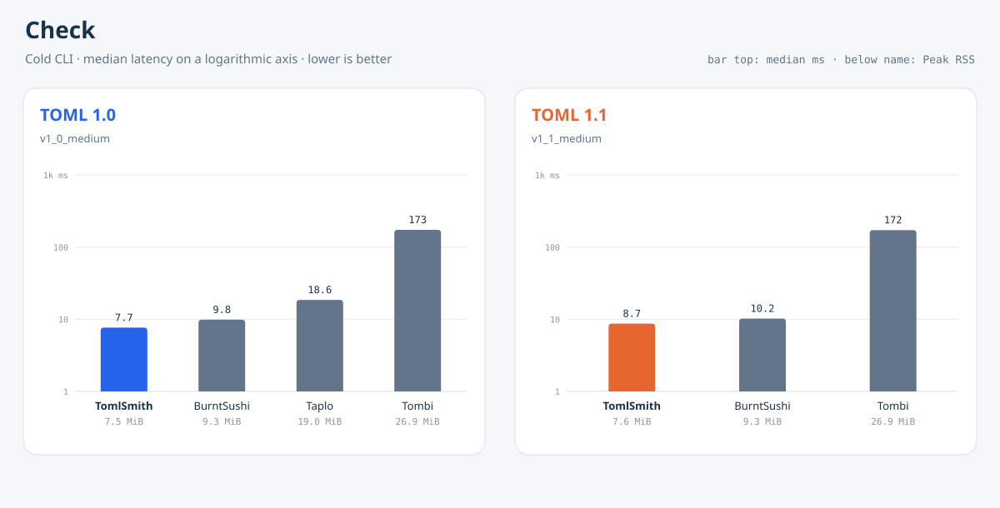
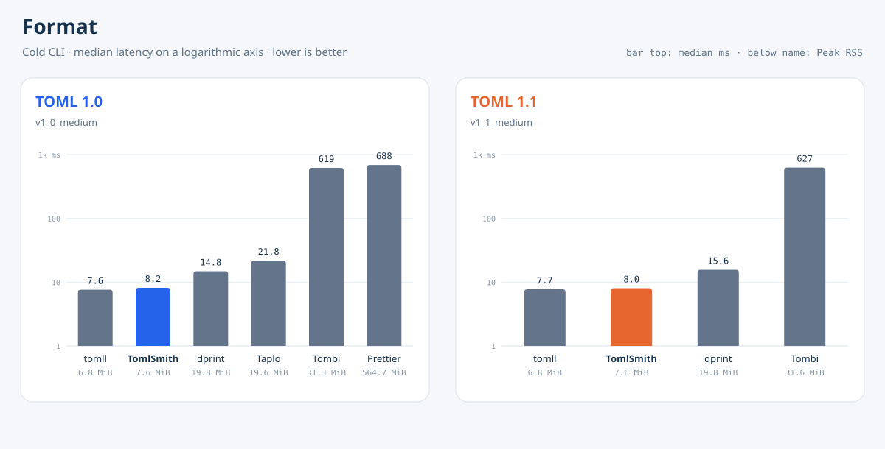

# TomlSmith Benchmark

**English** | [简体中文](README.zh-Hans.md)

[](https://github.com/tomlsmith/benchmark/actions/workflows/ci.yml) [](LICENSE)

TomlSmith Benchmark measures end-to-end cold-start latency, throughput, and peak memory for TOML checking and formatting CLIs. Each sample runs the product command in a new process instead of calling a parser library directly.

<!-- BENCHMARK_RESULTS_START -->
## Check

The check scenario uses deterministic synthetic documents covering the published TOML 1.0.0 and TOML 1.1.0 grammars. Only product/version pairs that accept the document under the selected version are shown.

**TOML 1.0 · `v1_0_medium`**

| Product | Median (ms) | Session range (ms) | MiB/s | Peak RSS (MiB) |
| --- | ---: | ---: | ---: | ---: |
| TomlSmith native CLI | 7.65 | 7.65–8.51 | 16.35 | 7.53 |
| BurntSushi/toml `tomlv` | 9.85 | 9.85–10.35 | 12.71 | 9.30 |
| Taplo CLI | 18.55 | 18.54–18.96 | 6.74 | 19.02 |
| Tombi | 173.20 | 173.20–183.09 | 0.72 | 26.88 |

**TOML 1.1 · `v1_1_medium`**

| Product | Median (ms) | Session range (ms) | MiB/s | Peak RSS (MiB) |
| --- | ---: | ---: | ---: | ---: |
| TomlSmith native CLI | 8.69 | 8.51–8.69 | 14.42 | 7.56 |
| BurntSushi/toml `tomlv` | 10.22 | 9.96–10.40 | 12.25 | 9.27 |
| Tombi | 171.63 | 171.63–184.62 | 0.73 | 26.86 |



## Format

The format scenario uses the same documents in an intentionally edited layout. Results require output that reparses under the selected version, preserves decoded content, and is unchanged by a second format pass.

**TOML 1.0 · `v1_0_medium`**

| Product | Median (ms) | Session range (ms) | MiB/s | Peak RSS (MiB) |
| --- | ---: | ---: | ---: | ---: |
| pelletier/go-toml `tomll`* | 7.62 | 7.27–7.62 | 16.42 | 6.77 |
| TomlSmith native CLI | 8.16 | 8.15–9.68 | 15.33 | 7.56 |
| dprint + TOML plugin | 14.83 | 14.83–15.39 | 8.44 | 19.77 |
| Taplo CLI | 21.82 | 21.82–26.17 | 5.73 | 19.58 |
| Tombi | 619.48 | 613.23–619.48 | 0.20 | 31.31 |
| Prettier + prettier-plugin-toml | 687.96 | 682.12–703.69 | 0.18 | 564.73 |

**TOML 1.1 · `v1_1_medium`**

| Product | Median (ms) | Session range (ms) | MiB/s | Peak RSS (MiB) |
| --- | ---: | ---: | ---: | ---: |
| pelletier/go-toml `tomll`* | 7.74 | 6.58–7.74 | 16.17 | 6.84 |
| TomlSmith native CLI | 8.04 | 7.81–8.78 | 15.57 | 7.62 |
| dprint + TOML plugin | 15.64 | 14.58–15.64 | 8.00 | 19.75 |
| Tombi | 626.94 | 626.94–689.98 | 0.20 | 31.62 |



\* `tomll` discards comments and rewrites literal styles, so it performs less work than the comment-preserving formatters.

Measured sequentially on 2026-10-23 on Apple M4 Pro, macOS 27.2, using published TomlSmith 0.4.1 and Rust 1.92.0. Each lane ran in three separate sessions with a 3-second warm-up, a 5-second measurement window, 30 samples, and three additional fresh-process Peak RSS samples per session. Tables and charts use session 2, selected before measurement; the range is the minimum and maximum of the three session medians, not a confidence interval. Overlapping ranges or differences within session drift do not establish a stable ordering.

Both README translations, charts, and the [website](https://tomlsmith.github.io/) share these measurements. The [machine-readable summary](assets/benchmark-data-20261023.json) records every session, product version, and raw-file checksum; complete result directories remain local under `results/` and are excluded from Git.
<!-- BENCHMARK_RESULTS_END -->

## Run locally

Install the exact published TomlSmith native CLI and the pinned competitor CLIs (prerequisites are in [CONTRIBUTING.md](CONTRIBUTING.md)):

```bash
./scripts/setup-products.sh
```

Run any exact lane, for example:

```bash
TOMLSMITH_BENCH_FILTER=e2e/check/cold-stdin/1.0/v1_0_medium \
  ./scripts/run-bench.sh local-check-v1_0

TOMLSMITH_BENCH_FILTER=e2e/check/cold-stdin/1.1/v1_1_medium \
  ./scripts/run-bench.sh local-check-v1_1

TOMLSMITH_BENCH_FILTER=e2e/format/cold-stdin/1.0/v1_0_medium \
  ./scripts/run-bench.sh local-format-v1_0

TOMLSMITH_BENCH_FILTER=e2e/format/cold-stdin/1.1/v1_1_medium \
  ./scripts/run-bench.sh local-format-v1_1
```

The manually dispatched `Benchmark` workflow accepts a `tomlsmith_ref` input to build the TomlSmith CLI from any git ref of the core repository before running the selected lanes. A locally built TomlSmith executable can be measured by exporting `TOMLSMITH_BIN` with `TOMLSMITH_BIN_EXPECTED_VERSION=any` (or an explicit version string) to relax the exact release pin, and `TOMLSMITH_BENCH_SKIP_PEAK_RSS=1` skips the peak-RSS pass on hosts without GNU `time`; published lanes leave both unset. Every timed sample starts a fresh process and reads the document from stdin; Peak RSS is the median of three separate fresh runs. Summarize any result directory with `scripts/summarize-results.py` and regenerate the charts with `scripts/generate-result-charts.py`.

Correctness, preflight, and resource-sampling process trees are bounded by `TOMLSMITH_BENCH_PROCESS_TIMEOUT_SECS` (120 seconds by default). The cross-product gate covers the four canonical medium-fixture publication lanes, while every other selected lane—including large and stress fixtures—must pass its own bounded preflight before timing. Timed iterations use the direct spawn path after that preflight so containment overhead is not counted as product latency. See the complete [measurement methodology](docs/methodology.md).

Run the pull-request gate with Node.js 24 and pnpm 11.22.0 available:

```bash
pnpm install --frozen-lockfile
./scripts/check.sh
```

Before publishing measurements, run the cross-product correctness gate for all four canonical publication lanes with `./scripts/check-products.sh`; any additional lane is verified again against its exact fixture by the benchmark runner. Scheduled and on-demand benchmark workflows upload complete result directories as temporary GitHub Actions artifacts. Raw directories and archives stay out of Git; a maintainer can promote an archive and its checksum to a GitHub Release when long-lived public evidence is needed.

## Contributing

Read [CONTRIBUTING.md](CONTRIBUTING.md) before opening a pull request. Participation is governed by the organization-wide [Code of Conduct](https://github.com/tomlsmith/tomlsmith/blob/main/CODE_OF_CONDUCT.md).

## License

MIT. See [LICENSE](LICENSE).
